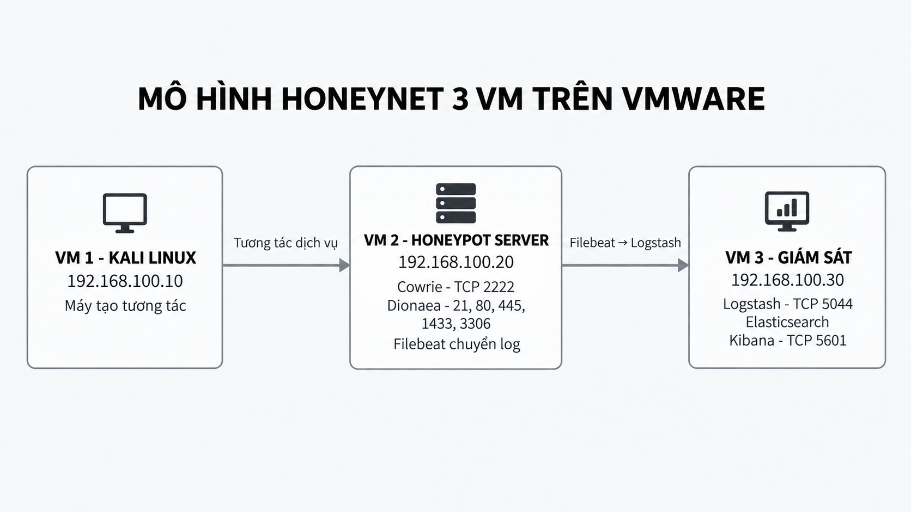
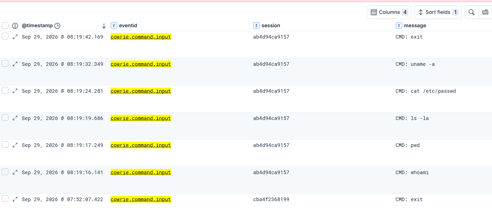
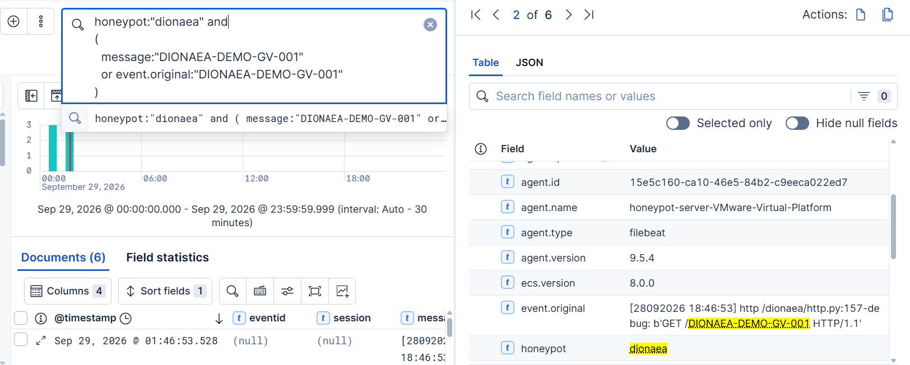
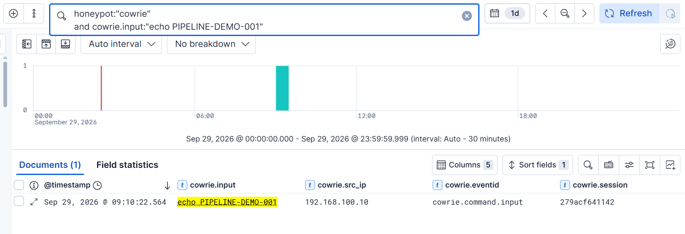

# Honeynet Security Monitoring with the Elastic Stack

A three-VM cybersecurity lab for collecting and investigating controlled interactions with SSH and network service honeypots. Kali Linux generates service scans, authentication attempts, shell commands and protocol requests against Cowrie and Dionaea. Filebeat forwards application logs to Logstash, which preserves Cowrie JSON fields and parses selected Dionaea connection records. Elasticsearch stores daily indices, and Kibana Discover supports searches by source, service, session and command. Five documented experiments demonstrate the collection path, including a marker traced from the original Cowrie log to Kibana. The project covers an isolated VMware Host-Only environment; its evidence does not establish Internet threat coverage or production readiness.

[Setup](docs/setup-guide.md) · [Experiments](docs/test-scenarios.md) · [Results](docs/results.md) · [Evidence](docs/evidence-catalog.md) · [Configuration provenance](configs/README.md)

## Key Features

- SSH authentication outcomes and lab credential capture with Cowrie.
- Simulated SSH shell command logging and session reconstruction.
- Dionaea FTP, HTTP, SMB, MSSQL and MySQL service connection monitoring.
- Centralized collection of Cowrie NDJSON and Dionaea text logs.
- Cowrie event time processing and Grok parsing of Dionaea accepted connections.
- Elasticsearch indexing and Kibana Discover queries for both honeypots.
- A documented event traced through the complete collection pipeline.

## Technology Stack

Versions below are visible in the supplied report; package/image availability has not been independently checked.

| Category | Technology | Purpose / documented version |
|---|---|---|
| SSH honeypot | Cowrie | Simulated shell and authentication logging; appendix shows package `3.0.15` being downloaded, final installed version not shown |
| Service honeypot | Dionaea | Five TCP service ports; `dinotools/dionaea:latest`, digest/version absent |
| Log collection | Filebeat | Filestream, NDJSON and Beats forwarding; `9.5.4` |
| Log processing | Logstash | Beats input, date/Grok/mutate filters; image `9.5.4` |
| Storage | Elasticsearch | Single-node daily indices; image `9.5.4` |
| Investigation | Kibana | Honeynet Data View and Discover; image `9.5.4` |
| Virtualization | VMware | Host-Only VMnet3; product version absent |
| Containers | Docker / Compose | Dionaea and ELK deployment; Dashboard Docker `29.1.3` visible, Compose version absent |
| Guest systems | Kali Linux, Ubuntu LTS | Traffic generator and two servers; exact releases not established |

## System Architecture

All three guests share `192.168.100.0/24` on VMware Host-Only **VMnet3**. The original diagram calls the servers VM2/VM3; the later operational guides call them VM3/VM4. IP addresses and roles agree. This repository uses role names and IPs to avoid ambiguity.

| Role | Lab IP | Components and ports |
|---|---|---|
| Traffic generator | `192.168.100.10` | Kali, Nmap, SSH, curl, Netcat |
| Honeypot Server | `192.168.100.20` | Cowrie SSH `2222`; Dionaea TCP `21,80,445,1433,3306`; Filebeat |
| Dashboard Server | `192.168.100.30` | Logstash Beats `5044`; Elasticsearch `9200`; Kibana `5601` |

Kali → Cowrie/Dionaea → local log files → Filebeat → Logstash → Elasticsearch → Kibana. The diagram is extracted unchanged from the source report. There is no dedicated gateway or Honeywall in this implementation.

## Deployment

1. Prepare Kali and two Ubuntu guests; create VMnet3 and assign the documented static IPs.
2. Use temporary NAT only for dependency downloads, then disconnect it before experiments.
3. Prepare Cowrie as its dedicated user and recover Dionaea container mount/service details.
4. On the Dashboard VM, stage the [ELK Compose and pipeline](configs/elk/docker-compose.yml), set the documented kernel parameter and start the stack.
5. Configure [Filebeat](configs/filebeat/filebeat.yml), confirm log read permissions and test its connection to `192.168.100.30:5044`.
6. Start the honeypots, confirm listening ports, and create Data View **Honeynet** for `honeynet-*` with `@timestamp`.
7. Open Kibana at `http://192.168.100.30:5601` and follow the [lab commands](tests/commands.md) and [KQL queries](tests/kibana-queries.md).

Follow the [setup and operations guide](docs/setup-guide.md) for exact commands, prerequisites and gaps. This is a source-based reconstruction with incomplete bootstrap details, not a fully reproducible deployment bundle.

**Configuration status:** Filebeat, Logstash and ELK Compose are manually checked transcriptions of source screenshots. Cowrie is a verified excerpt plus visible userdb rules. Dionaea Compose is explicitly a reference template with required missing values. No original standalone configuration exports were provided. See [configuration provenance](configs/README.md).

## Experimental Scenarios

Run these procedures only on the lab systems you control and are authorized to test.

| Scenario | Objective | Original evidence |
|---|---|---|
| 01 Network service scan | Observe advertised services and parsed connections | [Nmap](screenshots/dionaea/nmap-service-scan.png), [Discover](screenshots/dionaea/kibana-scan-events.png) |
| 02 SSH authentication | Record rejected and accepted lab passwords | [Client](screenshots/cowrie/ssh-authentication-client.png), [outcomes](screenshots/cowrie/kibana-authentication-events.png) |
| 03 Simulated shell | Record commands and correlate a session | [Shell](screenshots/cowrie/simulated-shell-client.png), [commands](screenshots/cowrie/kibana-command-events.png) |
| 04 Dionaea services | Trace HTTP marker and FTP connection | [HTTP](screenshots/dionaea/kibana-http-marker.png), [FTP](screenshots/dionaea/kibana-ftp-event.png) |
| 05 Collection pipeline | Trace `PIPELINE-DEMO-001` from source to Discover | [Source](screenshots/cowrie/pipeline-marker-source-log.png), [Elasticsearch](screenshots/elk/pipeline-elasticsearch-hit.png), [Kibana](screenshots/elk/pipeline-kibana-marker.png) |

Details, expected evidence and observed outcomes are in [test scenarios](docs/test-scenarios.md).

## Experimental Results

### SSH command visibility

The source evidence shows `whoami`, `pwd`, `ls -la`, `cat /etc/passwd`, `uname -a` and `exit` associated with session `ab4d94ca9157`. This earlier screenshot uses root-level Cowrie fields; the later pipeline uses `cowrie.*`.

### Dionaea request visibility

The controlled HTTP request is visible by marker `DIONAEA-DEMO-GV-001`. Its HTTP 404 response is part of the recorded experiment, not evidence of collection failure.

### End-to-end collection evidence

The marker event appears at the source, Logstash, Elasticsearch and Kibana, with session `279acf641142`. These are historical results from the supplied report; this repository build did not rerun the VMs. See [results and interpretation](docs/results.md).

## Project Limitations

- Three guests share a single Host-Only subnet; no inter-zone gateway/Honeywall policy was implemented.
- Honeypots emulate supported interactions; logged commands do not establish execution on a real operating system.
- Experiments use controlled lab traffic, with no representative Internet dataset or measured detection accuracy, throughput, latency or loss rate.
- Elasticsearch security is disabled in the documented lab configuration; transport is plaintext.
- Missing Cowrie bootstrap details and Dionaea mounts prevent a complete fresh deployment from these files alone.
- Discover evidence is available; a custom dashboard saved-object export, alert rules, PCAP and bulk raw logs were not supplied.

See [limitations and source discrepancies](docs/limitations.md).

## Future Improvements

Proposed work: recover and pin full deployment exports; add a segmented Honeywall with validated egress controls; export investigation dashboards and test detection rules against a repeatable labeled dataset. These are not completed features.

## Repository Guide

- [Source inventory and verification levels](docs/source-analysis.md)
- [Setup and operations](docs/setup-guide.md)
- [Five experimental scenarios](docs/test-scenarios.md)
- [Results](docs/results.md) and [limitations](docs/limitations.md)
- [Commands](tests/commands.md) and [Kibana queries](tests/kibana-queries.md)
- [Configurations](configs/README.md) and [source-derived sample event](sample-logs/README.md)
- [Evidence catalog](docs/evidence-catalog.md), [image integrity manifest](docs/evidence-manifest.json) and [verification record](docs/verification.md)
- [Rights and attribution](RIGHTS.md)

Original academic documents remain local to avoid publishing personal information and unrelated source material. No blanket license is assigned to the original group report, screenshots or third-party software.
