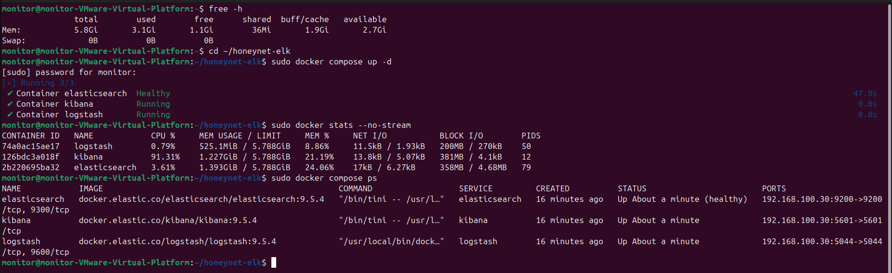
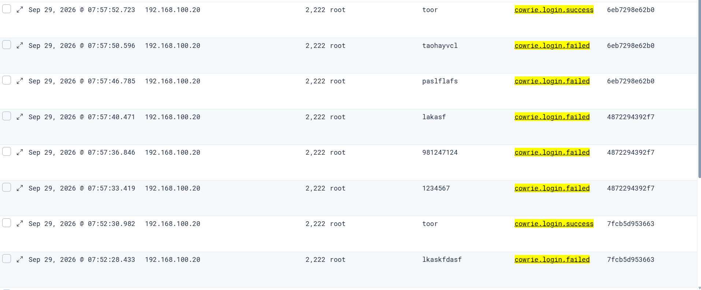

# Results and evidence

These results were observed in the supplied report's controlled lab experiments. The repository build reviewed the evidence and configuration transcriptions; it did not recreate or rerun the VM deployment.

| Observation | Supported conclusion | Source evidence |
|---|---|---|
| Five Dionaea ports are open and parsed connections are searchable | Multi-service connection collection works for the shown scan | S1 figures 3.1–3.2 |
| Failed SSH attempts and accepted `root/toor` logins appear | Cowrie records authentication outcomes | S1 figures 3.3–3.4 |
| Six shell inputs share session `ab4d94ca9157` | Session-based command reconstruction is possible | S1 figures 3.5–3.6 |
| HTTP marker is searchable despite a 404 response | Request logging does not require a successful resource response | S1 figures 3.7–3.8 |
| FTP source/port and internal destination are visible | Accepted TCP connection parsing is demonstrated | S1 figures 3.9–3.10 |
| One marker event appears across all collection stages | Historical end-to-end delivery of that identified event | S1 figures 3.11–3.16 |

## Infrastructure

Figure 2.14 shows Elasticsearch healthy and Kibana/Logstash running, bound to the Dashboard Host-Only address. The source healthcheck uses an HTTP response and does not test a specific green/yellow status.

## Cowrie authentication

Figure 3.4 shows multiple rejected attempts and accepted `root/toor` sessions. A login attempt count is not a TCP session count. The screenshot includes decoy credentials captured by the honeypot, not administrator passwords.

## Session reconstruction

For session `ab4d94ca9157`, figure 3.6 shows the following display times on September 29, 2026. The screenshot is reverse chronological; this table orders the six visible command events chronologically.

| Display time | Input |
|---|---|
| 08:19:16.141 | `whoami` |
| 08:19:17.249 | `pwd` |
| 08:19:19.686 | `ls -la` |
| 08:19:24.281 | `cat /etc/passwd` |
| 08:19:32.349 | `uname -a` |
| 08:19:42.169 | `exit` |

These inputs describe simulated host discovery. They do not establish real operating-system command execution. The extra earlier-session row in the source screenshot is excluded from this sequence.

## Dionaea interactions

The HTTP request marker `DIONAEA-DEMO-GV-001` is visible in `event.original`. The [client screenshot](../screenshots/dionaea/http-marker-client.png) records HTTP 404 for the nonexistent URI. The [FTP event](../screenshots/dionaea/kibana-ftp-event.png) shows `dst_port=21`, source `192.168.100.10` and container destination `172.17.0.2`. `target_ip=192.168.100.20` is added by the pipeline to preserve the logical host target.

Counts visible in Discover are specific to the screenshot's filters/time window. They are not treated as attack totals or detection metrics. Source text timestamps and ingestion/display time differ, so no transport latency is inferred.

## Traced pipeline event

| Stage | Matching evidence |
|---|---|
| Kali enters marker | [Figure 3.11](../screenshots/cowrie/pipeline-marker-client.png) |
| Cowrie source JSON | [Figure 3.12](../screenshots/cowrie/pipeline-marker-source-log.png) |
| Filebeat active and output OK | [Figure 3.13](../screenshots/elk/pipeline-filebeat-output.png) |
| Logstash receives namespaced event | [Figure 3.14](../screenshots/elk/pipeline-logstash-event.png) |
| Elasticsearch returns stored event | [Figure 3.15](../screenshots/elk/pipeline-elasticsearch-hit.png) |
| Kibana Discover retrieves event | [Figure 3.16](../screenshots/elk/pipeline-kibana-marker.png) |

The marker is `echo PIPELINE-DEMO-001`, session `279acf641142`, source time `2026-09-29T02:10:22.564012Z`. The source search returns one hit in `honeynet-2026.09.29`; Discover shows the corresponding UTC+7 display time `09:10:22.564`. A [manually transcribed source event](../sample-logs/cowrie-pipeline-marker.json) preserves the original values.

This establishes successful historical collection of the shown event. It does not establish sustained throughput, zero event loss, alerting, response automation or detection accuracy. See [limitations](limitations.md) and [verification status](verification.md).
